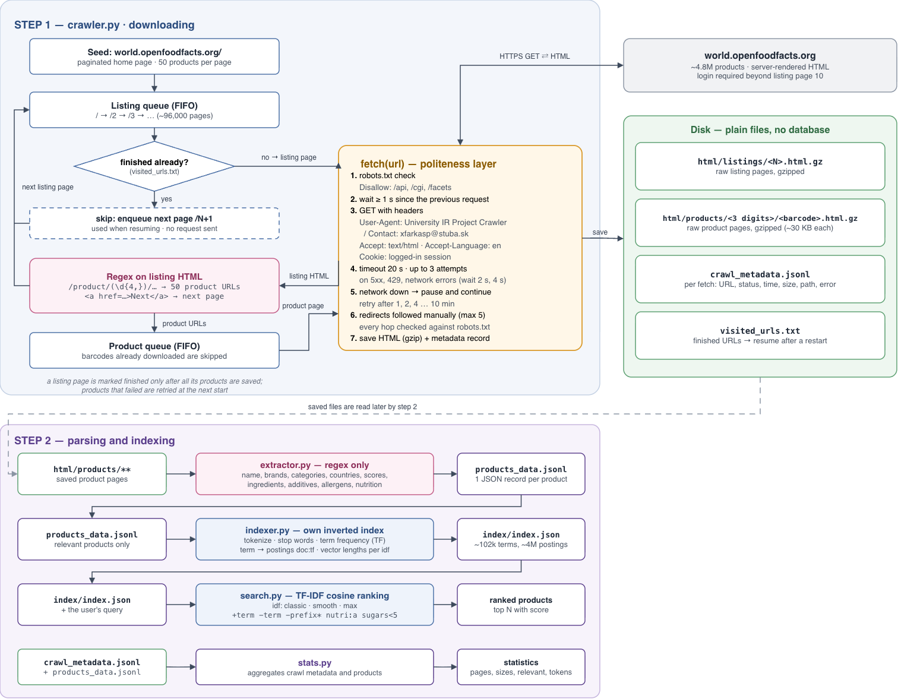

# OpenFoodFacts crawler — VINF project

Custom crawler and regex extractor for food product pages on
[world.openfoodfacts.org](https://world.openfoodfacts.org). Pages are downloaded
as raw HTML; no API, JSON dumps or FTP data are used.

## Data source

| | |
|---|---|
| Site | https://world.openfoodfacts.org |
| Example page | https://world.openfoodfacts.org/product/3017620422003/nutella |
| Size of the site | ~4.8 million products, listed on ~96,000 pages of 50 |
| Extracted fields | product name, brands, quantity, categories, labels, countries, Nutri-Score, Green-Score (Eco-Score), ingredients (+ their language), additives (E-numbers), allergens, traces, nutrition per 100 g |
| Candidate Wikipedia join keys | brands, categories, countries, additives (E-numbers), labels |

## Frameworks and libraries

| Library | Used for | Why |
|---|---|---|
| Python 3.9+ | everything | |
| `requests` | HTTP | Simple sessions (keep-alive, shared headers/cookie) and fine control over redirects and timeouts |
| `re` (stdlib) | link and data extraction | The course requires regex extraction, not parsing by exact page structure (XPath/DOM) |
| `urllib.robotparser` (stdlib) | robots.txt | Standard parser for the robots exclusion protocol |
| `gzip`, `json` (stdlib) | storage | Compressed HTML cache, JSON Lines for metadata and extracted records — no database |

No crawling frameworks (Scrapy, Selenium, …) are used. The site renders on the
server, so JavaScript execution is not needed.

## Architecture



Crawling and extraction are separate steps. The crawler only downloads and
stores pages, so the extractor can be improved and re-run at any time without
downloading anything again (and later moved to Spark).

**Discovery.** Category and brand listings (`/category/...`, `/brand/...`) all
redirect to `/facets/...`, which robots.txt disallows. The paginated home page
`/`, `/2`, `/3`, … is allowed and lists every product, so it is the seed.
The crawl is breadth-first: one listing page, then its 50 products, then the next page.

**Login.** The site serves listing pages beyond `/10` only to
logged-in users (HTTP 401 otherwise: *"Due to heavy abuse from robots, we are
unable to serve this page to unidentified users. Please create a free Open
Food Facts account"*). The crawler sends the session cookie of a registered
account (`off_cookie.txt`, not committed).

**Resuming.** Every finished product URL goes to `visited_urls.txt`. A listing
page is marked visited only after all its products are saved. On restart, known
products are skipped and finished listing pages are passed over without
being fetched again. Products that failed in earlier runs (read from
`crawl_metadata.jsonl`) are retried first.

**Network outages.** When a request gets no response at all (DNS failure,
connection error, timeout - e.g. the laptop went to sleep), the crawler waits
1, 2, 4 … up to 10 minutes and tries again until the network is back, instead
of ending the crawl.

## Headers, timeouts and delays

| Setting | Value | Reason |
|---|---|---|
| `User-Agent` | `University IR Project Crawler / Contact: xfarkasp@stuba.sk` | The crawler identifies itself with a contact, as is polite for crawlers; it does not pretend to be a browser |
| `Accept` | `text/html,application/xhtml+xml` | Only HTML pages are wanted |
| `Accept-Language` | `en` | English labels ("Brands:", "Allergens:") that the regexes depend on |
| `Cookie` | session cookie of a registered account | Needed for listing pages beyond `/10` (see Login) |
| Delay between requests | 1 s (raised automatically if robots.txt sets a higher `Crawl-delay`) | At most 1 request/s to one site, as recommended in the lecture; applies to retries, redirects and robots.txt too |
| Timeout | 20 s | Product pages are ~200–800 KB and usually arrive in ~1 s; 20 s allows for a slow server without hanging |
| Retries | 3 attempts, waiting 2 s and then 4 s | Only for temporary errors (5xx, 429, timeouts, connection errors); 4xx are not retried |
| Network outage | wait 1, 2, 4 … 10 min, then retry | A sleeping laptop or lost Wi-Fi pauses the crawl instead of ending it |
| Redirects | followed manually, max 5, each hop checked against robots.txt | Product slugs redirect (e.g. `nutella-ferrero` → `nutella`), and some redirects lead to the disallowed `/facets/` |
| robots.txt | checked for every URL | `/api`, `/cgi`, `/facets` are disallowed for all crawlers |

## Crawl metadata

`crawl_metadata.jsonl` holds one record per fetch, including failed ones:

| Field | Example | Meaning |
|---|---|---|
| `url` | `…/product/7622202334009/dairy-milk` | Requested URL |
| `final_url` | `…/product/7622202334009/dairy-milk-cadbury` | URL after redirects |
| `page_type` | `product` | `listing` or `product` |
| `barcode` | `7622202334009` | Product barcode (unique ID) |
| `fetched_at` | `2026-10-10T19:31:44+00:00` | Fetch time (UTC) |
| `status` | `200` | HTTP status |
| `content_type` | `text/html; charset=UTF-8` | Response content type |
| `attempts` | `1` | Number of attempts made |
| `elapsed_ms` | `1826` | Time taken, including retries and redirects |
| `size_bytes` | `173323` | Raw HTML size |
| `size_gzip_bytes` | `26164` | Size stored on disk |
| `html_path` | `html/products/762/7622202334009.html.gz` | Where the HTML is stored |
| `links_found` | `50` | Product links found (listing pages only) |
| `error` | `null` / `HTTP 401` | Failure reason |

## URL extraction (regex)

[`crawler.py:264`](crawler.py#L264) — listing pages build their product grid
with JavaScript from data embedded in the page, so product links are found with
a regex over the raw HTML instead of `<a href>` tags:

```python
PRODUCT_LINK_RE = re.compile(r"/product/(\d{4,})(?:/([A-Za-z0-9_.%-]*))?")
NEXT_PAGE_RE = re.compile(r'<a\s[^>]*href="([^"]+)"[^>]*>\s*Next\s*</a>', re.IGNORECASE)
```

`extract_product_links()` ([`crawler.py:269`](crawler.py#L269)) keeps one URL per barcode,
which is the URL normalisation: one product, one document.

## Data extraction (regex)

[`extractor.py`](extractor.py) uses only regular expressions. The patterns
match visible labels, link targets, image names and text patterns rather than
the exact structure of the page:

| Field | Pattern matches |
|---|---|
| brands, categories, labels, countries, quantity | label text: `<span class="field">Brands: </span> … </p>`, then the link texts |
| nutri_score / eco_score | badge image name: `nutriscore-e-new-en.svg`, `green-score-a-plus.svg` |
| additives | headings like `E322 - Lecithins`; fallback: `E\d{3,4}` in the ingredients |
| allergens / traces | `<strong>Allergens:</strong> milk, nuts` |
| nutrition_100g | rows of the "Nutrition facts" table, using the column whose header contains "100 g" |

Checked against the earlier DOM-based (BeautifulSoup) parser on 569 crawled
pages: the results are identical for every field. `tests/` keeps 20 of these
pages with the DOM parser's values as unit tests, plus edge cases.

## Index and search

[`indexer.py`](indexer.py) builds our own inverted index (no database, no Lucene)
from `products_data.jsonl` into `index/index.json`:

- **Document:** one relevant product (has a name and ingredients or nutrition),
  text = name, brands (both counted twice), categories, labels, countries,
  ingredients, additive codes and names, allergens, traces.
- **Text operations:** lowercase, accents removed, split on non-alphanumerics,
  English and French stop words, numbers and one-letter tokens removed. No lemmatization.
- **Index:** term → postings `doc:tf,…` (term frequencies), plus the vector
  length of every document for each idf method. Rebuilt from scratch after each
  extractor run (~8 s for 78k products).

[`search.py`](search.py) ranks with TF-IDF cosine similarity
(`(1 + log tf) × idf` weights) times the share of query terms found in the
document. Three idf methods (the probabilistic idf is not used):

| Method | Formula |
|---|---|
| classic | `log10(N / df)` |
| smooth | `log10(N / (1 + df)) + 1` |
| max | `max(log10(max_df / (1 + df)), 0)` |

Query syntax: `+term` (must contain), `-term` (exclude), `-palm*` (exclude every
term starting with `palm`), `nutri:a,b`, `eco:a+`,
`sugars<5`, `proteins>20`, `kcal<200`, `fat<10`, `carbohydrates<30`.

## Usage

```bash
python3 -m venv .venv && .venv/bin/pip install -r requirements.txt

# crawl (resumable; Ctrl-C or `pkill -f crawler.py` stops it safely)
.venv/bin/python crawler.py                    # until the queue is empty
.venv/bin/python crawler.py --max-products 100 # test run
nohup .venv/bin/python crawler.py > /dev/null 2>&1 &   # in the background, log in crawler.log

.venv/bin/python extractor.py   # html/products/** -> products_data.jsonl
.venv/bin/python indexer.py     # products_data.jsonl -> index/index.json
.venv/bin/python search.py "breakfast cereals nutri:a -palm"
.venv/bin/python search.py "organic chocolate milk" --compare   # all idf methods
.venv/bin/python search.py      # interactive
.venv/bin/python stats.py       # pages, sizes, failures, relevant products, tokens
.venv/bin/python -m unittest discover tests -v
```

## Files

| Path | Contents |
|---|---|
| `crawler.py` | Crawler: fetching, politeness, link extraction, storage |
| `extractor.py` | Regex extractor: stored HTML → `products_data.jsonl` |
| `indexer.py` | Own inverted index: `products_data.jsonl` → `index/index.json` |
| `search.py` | Search engine: TF-IDF cosine ranking, 3 idf methods, filters |
| `stats.py` | Crawl, product and token statistics |
| `tests/` | Unit tests of the regex extractors, with real crawled pages as fixtures |
| `wiki/` | Wiki pages (DokuWiki syntax) for the consultations and the submission |
| `html/` | Raw HTML cache (gzip) — never deleted |
| `crawl_metadata.jsonl` | Metadata for each fetch |
| `products_data.jsonl` | Extracted products (rebuilt by `extractor.py`) |
| `index/` | The index (rebuilt by `indexer.py`, not committed) |
| `visited_urls.txt` | Finished URLs, used when resuming |
| `off_cookie.txt` | Login cookie (private, not committed) |
