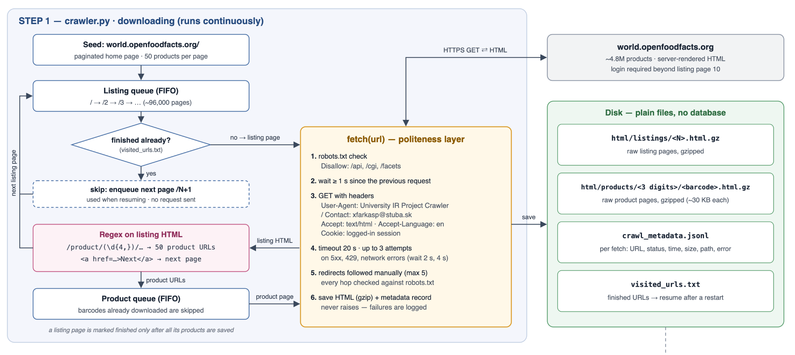

# Consultation 2 — OpenFoodFacts crawler

Source: https://world.openfoodfacts.org (product pages, raw HTML; no API or data dumps)

## Aké frameworky chcete používať?

| Library | Used for | Why |
|---|---|---|
| Python 3.9+ | everything | |
| `requests` | HTTP | Sessions (keep-alive, shared headers and cookie), control over timeouts and redirects |
| `re` (stdlib) | link and data extraction | The course requires regex extraction, not extraction by exact page structure (XPath/DOM) |
| `urllib.robotparser` (stdlib) | robots.txt | Standard parser for the robots exclusion protocol |
| `gzip`, `json` (stdlib) | storage | Compressed HTML cache, JSON Lines metadata — no database |

No crawling frameworks (Scrapy, Selenium, …) and no HTML parser. The site renders on the server, so JavaScript execution is not needed.

## Diagram architektúry vášho crawl systému



- **Seed:** the paginated home page `/`, `/2`, … (~96k pages × 50 products). Category pages redirect to `/facets/`, which robots.txt disallows.
- **Strategy:** breadth-first: one listing page, its 50 products, then the next page.
- **Deduplication:** one document per product barcode.
- **Resuming:** `visited_urls.txt` lists finished pages; everything is written to disk immediately.
- **Crawling and extraction are separate:** the extractor runs over the stored HTML, so it can be re-run without downloading again.

## Aké hlavičky používate, aký timeout/sleep?

| Setting | Value | Reason |
|---|---|---|
| `User-Agent` | `University IR Project Crawler / Contact: xfarkasp@stuba.sk` | The crawler identifies itself with a contact; it does not pretend to be a browser |
| `Accept` | `text/html,application/xhtml+xml` | Only HTML is needed |
| `Accept-Language` | `en` | English labels ("Brands:", "Allergens:") used by the regexes |
| `Cookie` | session of a registered account | Listing pages beyond `/10` return HTTP 401 to anonymous users ("Due to heavy abuse from robots… create a free account") |
| Sleep | 1 s between all requests | At most 1 request/s to one site, as in the lecture; raised automatically if robots.txt sets a higher `Crawl-delay` |
| Timeout | 20 s | Pages are 200–800 KB and usually arrive in ~1 s |
| Retries | 3 attempts, waiting 2 s and then 4 s | Only for 5xx, 429 and network errors; 4xx are not retried |
| Redirects | followed manually, max 5 | Each hop is checked against robots.txt (`/api`, `/cgi`, `/facets` are disallowed) |

## Implementácia crawlera + zopár už stiahnutých stránok

**Code**

| File | Contents |
|---|---|
| `crawler.py` | `fetch()` — politeness, retries, redirects; `extract_product_links()` — regex link extraction; `save_html()`, `save_metadata()` — storage; `crawl()` — main loop |
| `extractor.py` | Regex extraction of product fields from the stored HTML |
| `stats.py` | Page counts, sizes on disk, failures |

URL extraction (`crawler.py`). The product grid is drawn with JavaScript from data embedded in the page, so the links are found with a regex over the raw HTML:

```python
PRODUCT_LINK_RE = re.compile(r"/product/(\d{4,})(?:/([A-Za-z0-9_.%-]*))?")
NEXT_PAGE_RE = re.compile(r'<a\s[^>]*href="([^"]+)"[^>]*>\s*Next\s*</a>', re.IGNORECASE)
```

**Downloaded so far** (12.10.2026)

|  | pages | raw HTML | gzipped |
|---|---:|---:|---:|
| listing pages | 900 | 690.9 MB | 32.1 MB |
| product pages | 44,717 | 9.1 GB | 1.3 GB |
| **total** | **45,617** | **9.8 GB** | **1.4 GB** |

Average fetch time: 1.04 s. Failed fetches: 48 of 45,665, all network errors on the client side (47 `ConnectionError`, 1 `ChunkedEncodingError`).

**Sample of downloaded pages**

| Barcode | URL | Raw | Gzipped | Stored as |
|---|---|---:|---:|---|
| 6111246721261 | [fromage-blanc-nature-milky-food-professional](https://world.openfoodfacts.org/product/6111246721261/fromage-blanc-nature-milky-food-professional) | 230 KB | 34 KB | `html/products/611/6111246721261.html.gz` |
| 5000169061046 | [baked-beans-in-tomato-sauce-essential-waitrose](https://world.openfoodfacts.org/product/5000169061046/baked-beans-in-tomato-sauce-essential-waitrose) | 228 KB | 34 KB | `html/products/500/5000169061046.html.gz` |
| 8410066138968 | [puree-de-tomates-heinz](https://world.openfoodfacts.org/product/8410066138968/puree-de-tomates-heinz) | 200 KB | 30 KB | `html/products/841/8410066138968.html.gz` |
| 3270160742189 | [2-filets-de-daurade-royale-avec-peau-picard](https://world.openfoodfacts.org/product/3270160742189/2-filets-de-daurade-royale-avec-peau-picard) | 187 KB | 29 KB | `html/products/327/3270160742189.html.gz` |
| 4056489615910 | [peanut-butter-smooth-maribel](https://world.openfoodfacts.org/product/4056489615910/peanut-butter-smooth-maribel) | 187 KB | 28 KB | `html/products/405/4056489615910.html.gz` |

Product pages are stored in folders named after the first 3 digits of the barcode, so no folder holds too many files.

**Crawl metadata record** (one per fetch, `crawl_metadata.jsonl`):

```json
{"url": "https://world.openfoodfacts.org/2", "final_url": "https://world.openfoodfacts.org/2",
 "page_type": "listing", "barcode": null, "fetched_at": "2026-10-10T16:36:05+00:00",
 "status": 200, "content_type": "text/html; charset=UTF-8", "attempts": 1, "elapsed_ms": 1154,
 "size_bytes": 801760, "size_gzip_bytes": 36208, "html_path": "html/listings/2.html.gz",
 "links_found": 50, "error": null}
```
